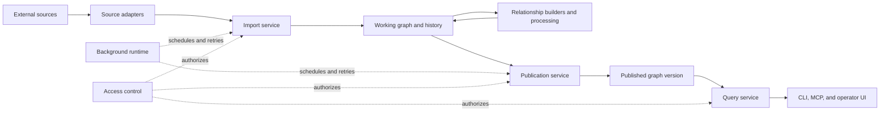

# System architecture

AKMON turns bounded source data into checked, versioned graph results.
Publication is its central safety boundary: importing or deriving a change
updates private working state, but only the publication service can make a
complete candidate visible to ordinary readers.

AKMON is the application. The Operational Knowledge Graph, or OKG, is the
knowledge graph an AKMON deployment manages.

## System map

Several boxes can run in one process or use the same PostgreSQL database,
but remain separate responsibilities: scheduling an import does not authorize
it, completing an import does not publish it, and finding a record does not let
a query modify it.

## Main components

| Component | Receives | Returns | Controls |
| --- | --- | --- | --- |
| Deployment configuration | Manifest, source definitions, graph model, checks, credential references, runtime settings | Validated settings or a specific error | Which configuration applies to this deployment |
| Source adapter | Approved source scope, optional credential, previous saved cursor or revision | Records, relationships, evidence, and the next cursor or revision | How one source is read and translated |
| Import service | Adapter output or another authorized batch | Accepted, rejected, and held changes; receipts; committed cursor or revision | Admission into working state and safe retry |
| Graph store | Accepted graph changes and checkpoint requests | Mutable branch state, history, and immutable checkpoints | Persistence and graph version history |
| Relationship builders and processing | A fixed candidate graph plus configured rules | Derived records or relationships with evidence | What the configured rule derives; never publication |
| Publication service | Working checkpoint, graph model, builders, and required checks | A published `generation_id` or a blocked result | Whether the reader-visible graph version advances |
| Query service | Reader identity, deployment, generation, and bounded request | Records, relationships, evidence, counts, or a bounded error | Read authority and the graph version used for the request |
| Background runtime | Scheduled work, retry policy, and deployment identity | Durable progress, retry state, and terminal failures | When work runs; not what graph result is correct |
| Access control | Identity, requested action, resource, and deployment policy | Auditable allow or deny | Whether an operation may proceed |

Failures do not cross these boundaries: an unsuccessful source read does not
advance its saved cursor or revision, a rejected change keeps its reason, a
blocked publication leaves the previous published checkpoint active, and an
unauthorized query returns an error.

## Implementation map

The [data lifecycle](../../start/data-lifecycle.md) explains the end-to-end
behavior. The corresponding code locations:

| Stage | Implementation |
| --- | --- |
| Read a source | Adapter interface in `src/okg/substrate/library/sources/base.py`; built-ins in `src/okg/substrate/library/sources/` |
| Validate and store imported changes | `src/okg/substrate/ingest/`, `src/okg/substrate/fact_batch.py`, and `src/okg/substrate/fact_application.py` |
| Store working state and checkpoints | `ChronosGraphStore` in `src/okg/substrate/graph_store.py` |
| Build derived records and relationships | `src/okg/substrate/projection/`, `src/okg/substrate/enrichers/`, and `src/okg/substrate/library/linkers/` |
| Check and publish a candidate | `Publisher.cycle()` under `src/okg/substrate/publisher/` |
| Read a published version | `src/okg/substrate/mcp/`; command-line entry points include `okg search` and `okg trace` |

## Maintenance, disagreement, and background work

The consistency library evaluates claims, corrections, dependencies, and
disagreement, producing effective claims, conflict findings, or contested
results. Its runtime integration is experimental and much narrower than the
normal publication pipeline; it provides no general incremental
maintenance for every builder and view. The contract is in
[Incremental maintenance and claim consistency](consistency.md).

The background runtime schedules, retries, and resumes imports and publication.
It preserves progress and terminal failure, but does not decide whether a
relationship is supported or a candidate is fit to publish. See
[Background work](runtime.md).

## Exchange between deployments

Deployments can exchange bounded graph evidence without sharing a database,
policy, or publication authority.

| Service | Receives | Returns | Boundary |
| --- | --- | --- | --- |
| Poros | Signed, bounded graph envelope and sender/receiver trust material | Verified receipt and, when admissible, a receiver-side admission candidate | The receiver verifies identity, signature, scope, replay, and catalog compatibility. A receipt is not publication. |
| Nomos | Identity, action, resource, and deployment policy | Auditable allow or deny | Required authority fails closed. An allow permits the owning component to continue; it does not validate or publish graph data. |
| Federation | Peer route, mailbox message, and detached objects | Delivery and mailbox status | Transport does not replace Poros validation, receiver policy, admission, or publication. |

The receiving deployment owns admission and publication. Rejected,
quarantined, or incomplete exchanges remain visible as such; they do not become
partial imports. Implementations live under `src/okg/substrate/exchange/`,
`src/okg/substrate/nomos/`, and `src/okg/substrate/federation/`.

## Optimization trials

Althea is an advanced library for comparing bounded graph rewrites before a
developer or operator decides whether to execute one. It is not an autonomous
promotion service.

| Step | Input | Output |
| --- | --- | --- |
| Lowering | AKMON read operation | Optimizer intermediate representation |
| Rewrite validation | Template, parameter schema, and supported dialect | Validated rewrite program or explicit rejection |
| Candidate search | Validated program, bounded choices, and scoring rules | Ranked candidates with evidence references |
| Acceptance | Trial identity, assertions, measurements, and policy | Pure accept, reject, or blocked result |

Candidate generation must stay within the declared search space and resource
limits, and acceptance binds to the exact trial and measurements. Missing or
stale evidence, an unsupported dialect, or an invalid trial identity blocks or
rejects the result; a score never grants write authority. A first-ranked
candidate proves neither global optimality nor factual truth.

Althea does not write a working branch or advance a published-generation
pointer. A caller that chooses an accepted rewrite must submit it through the
normal access, graph-write, validation, and publication components. The library
lives under `src/okg/optimizer/`.

## Where to continue

- [Code architecture](pipeline.md) maps these responsibilities to packages and
  call paths.
- [Built-in capabilities](../../reference/capabilities.md) states current
  availability and experimental limits.
- [Reference](../../README.md#reference) contains exact command, result, and API
  contracts.
