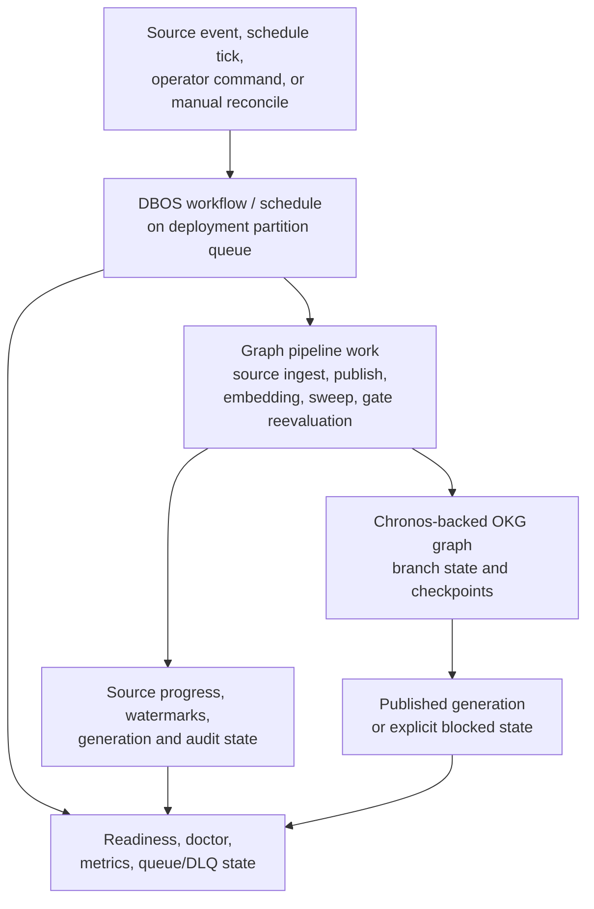

# Background work

Source synchronization and publication must continue when no developer is
watching, with durable identity, visible progress, and bounded retry. The
runtime provides that execution boundary; it does not decide what a source
change means or whether a candidate is fit to publish.

AKMON uses a durable workflow runtime for work that must survive a retry or
process restart. The long-lived worker schedules, queues, resumes, and reports
source-sync, publisher, embedding, sweep, and operator-drain work.

For the graph data model, read
[AKMON model](../../start/concepts.md). For the pipeline it drives, read
[Ingest and publish pipeline](pipeline.md).

## Names used in code

Reader-facing documentation calls this **background work**. Code and older
design records may call the same area `runtime`, DBOS, or Logistike. DBOS is the
workflow library; `okg runtime worker` is the long-lived process.

## The runtime contract

The runtime receives a serializable task identity, deployment, schedule or
operator trigger, and retry policy. It returns durable workflow status,
progress, retry attempts, and a terminal result or visible failure. It owns
when work runs and whether it can be resumed; it does not own the meaning of
the graph result.

| Runtime job | Receives → returns | Boundary and failure behavior |
|---|---|---|
| Start source synchronization | Source event, poll tick, webhook, or manual reconcile → source-sync workflow status and ingest result | A wakeup says “read again”; the source adapter decides what changed. Malformed trigger input is reported, not broadened into another source. |
| Run publication | Schedule or operator request → publisher workflow result | Workflow completion is not publication. The publisher still runs its checks and owns the published pointer. A retry repeats the idempotent operation; it cannot declare success by itself. |
| Evaluate opt-in reuse | Successful published summary in `consistency-fixture` → reuse status or error | The current hook runs after publication with retries disabled. Its error remains visible in the result but cannot invalidate the published generation. It is not a general deployment workflow. |
| Retry and resume work | Workflow identity and DBOS state → resumed attempt or terminal failure | Exhausted retries remain visible in status/DLQ. A missing DBOS row is unavailable, never a healthy default. |
| Drain for an operator | Deployment and bounded drain request → drained result or timeout with active workflow ids | A timeout reports in-flight work and stops safely; it does not discard work or claim that the graph is current. |

The runtime can wake source sync and retry the publisher, but only the
consistency component decides whether an earlier claim result has enough
dependency evidence to be reused. A workflow retry is not reuse evidence.

## Responsibilities

| Responsibility | Plain meaning | Current implementation surface |
|---|---|---|
| Runtime worker | The long-lived process that launches DBOS for a deployment. | `okg runtime worker --deployment <name>` |
| Durable workflows | Work that can be queued, retried, resumed, or inspected through DBOS state. | DBOS workflow rows and deployment partition queues |
| Schedules | Cron-like triggers for recurring AKMON work. | DBOS schedules registered at worker boot |
| Source sync | Wakeups from file changes, git ref changes, webhooks, poll probes, or manual reconcile. | `okg_source_sync` workflow plus source progress and watermarks |
| Publisher work | Publication, gate reevaluation, and generation-visible work. | Publisher workflows, advisory coordination, generation records |
| Reuse evaluation | Post-publish, no-retry evaluation of the unchanged claim fixture when enabled. | `reuse_pass_workflow.py`; decisions remain in `consistency/reuse_scheduler.py` |
| Embedding work | Background population of graph-node embeddings when enabled. | `okg_embed_batch` workflow |
| Sweeps | Cleanup or timeout jobs that keep runtime state from silently stalling. | Lens putback, escalation timeout, gate reevaluation, stale workflow cleanup |
| Operator drain | Bounded mode for processing queued deployment work and exiting. | Runtime worker drain mode |

## Execution flow

A wakeup is not source data. A filesystem event, webhook, or poll tick says
"look again." The adapter determines what the source reports by reading it,
comparing cursors or fingerprints, and emitting observations. That does not
establish whether a source claim is factually true.

## Relationship to other components

| Piece | Relationship to background work |
|---|---|
| AKMON | The DBOS runtime runs AKMON's background and operator-requested work. |
| OKG | Background work changes or checks the OKG graph model. |
| Ingest/publish pipeline | The implementation package provides the ingest, publish, gate, and MCP code that workflows call. |
| Chronos | Workflows write graph changes to Chronos branches and publish checkpoints as generations. |
| Nomos | Sensitive effects still require policy decisions; execution durability does not bypass authorization. |
| Poros | Received graph exchange can enqueue admission and publish work through the same runtime path. |

## Operational signals

When background work is unhealthy, the graph may be readable but not current.
Check these signals before claiming graph-ready evidence:

| Signal | What it tells you |
|---|---|
| Runtime worker state | Whether supervised DBOS workers are alive for the deployment. |
| Source freshness | Whether readiness-required sources have reconciled recently enough. |
| Queue depth | Whether active work is draining. |
| DLQ count | Whether workflows failed after retry exhaustion. |
| Doctor status | Whether deployment health checks agree with the runtime state. |
| Published generation | Whether recent work actually became read-side graph state. |

For operator steps, use [Deployment runtime](../../operate/deployments/runtime.md),
[Runtime queue recovery](../../runbooks/troubleshooting/runtime-queue.md), and
[Source sync not firing](../../runbooks/troubleshooting/source-sync.md).
